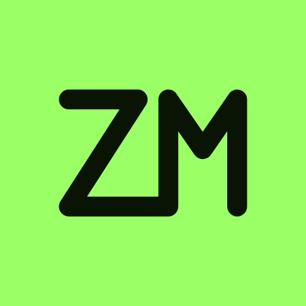

<p align="center">
  
</p>

<p align="center"><a href="README.md">Español</a> · <b>English</b></p>

# ZM Studio · All your AI assistants in one place.

**ZM Studio is a collaboration platform that brings your favorite AI tools into a single workspace.**

Work with Codex, Claude Code, Gemini CLI and OpenCode on your project at the same time. They all share a memory that you can see and control. You decide what each one may change. Everything that happens is recorded on your machine.

## Key features

- **Unified integration** - Reach several assistants from one interface
- **Shared memory** - Agents see the project context and learn from every turn
- **Full control** - Read-only by default, with granular permissions per message
- **100% local** - Nothing leaves your machine without your permission
- **Auditable history** - Every decision, change and permission is recorded

## Install

**macOS, Linux and Windows (WSL2).**

```bash
npx @zarzmr/app
```

Requires Node.js 22.5 or newer and at least one AI assistant set up. There is no account to create. ZM Studio opens in your browser with a step-by-step guide.

## How it works

1. Connect your AI assistants (Codex, Claude Code, etc.)
2. Open a project in ZM Studio
3. Write instructions in plain language
4. The assistants propose changes
5. Approve, reject or edit each change
6. The history stays on your machine

## License

**Free for individuals and for teams of up to 10**, also when you use it to work for your clients.

Larger organizations, or anyone who wants to offer ZM Studio as a service, need a commercial license: write to hola@jossuealcala.com.

The code is public ([Business Source License 1.1](LICENSE)). It is not an open source license, but each version becomes [GNU AGPL v3](https://www.gnu.org/licenses/agpl-3.0.html) four years after it is published. Versions up to 1.0.5 keep the license they were released with. The ZM name and logo are trademarks of Jossue Alcalá ([TRADEMARKS.en.md](TRADEMARKS.en.md)).

---

[CHANGELOG](CHANGELOG.en.md) · [Documentation](docs/REFERENCE.md) · [Writing a module](docs/SDK.md) · [Security](SECURITY.md) · [Contributing](CONTRIBUTING.md) · [Issues](https://github.com/zarzmra/ZM-Studio/issues)

© 2026 [Jossue Alcalá](https://jossuealcala.com)
